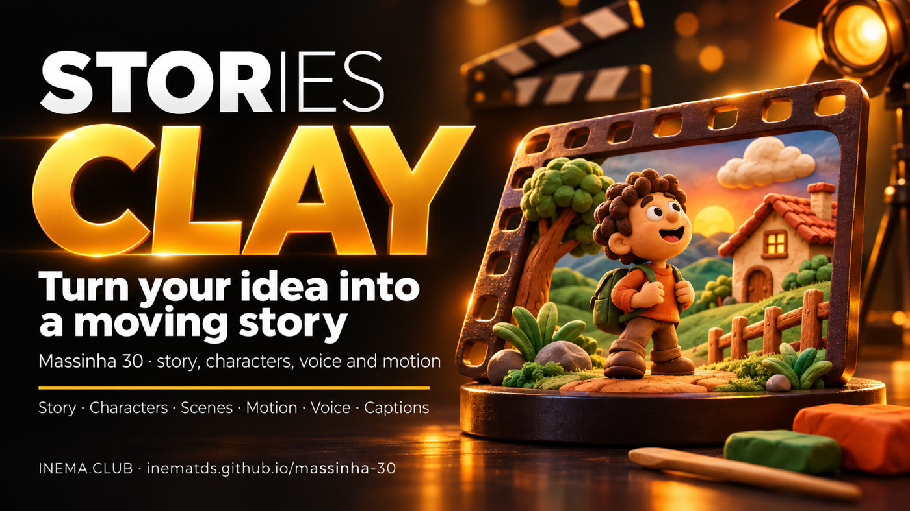

# Massinha 30

[](https://linnoff88-dev.github.io/arckhe-/guia/en/)

**🇧🇷 [Português](README.md) · 🇺🇸 [English](README.en.md) · 🇪🇸 [Español](README.es.md)**

## What it is

You have a story idea, but getting the characters, voice, and scenes to work together takes effort. Massinha 30 is a toolkit for creating short narratives with a handcrafted clay look. It organizes the approved script, character references, clips generated with Kling, ElevenLabs narration, and captions. It is for creators who want to repeat the process with new stories. Production requires access to the generation services; the guide is free to read.

## User guide

https://linnoff88-dev.github.io/arckhe-/guia/en/

Open the project in Codex and ask: “Use skills/massinha-30/SKILL.md to create a new claymation story.” Read [the complete workflow](skills/massinha-30/references/producao.md).

Python 3.10+, FFmpeg/ffprobe with libass, the official authenticated Kling CLI, and ElevenLabs configured. The agent generates images with image_gen through its subscription. Installation does not generate video or make paid calls.

```bash
git clone https://github.com/linnoff88-dev/massinha-30.git
cd massinha-30
python3 -m unittest discover -s tests -v
python3 skills/massinha-30/scripts/pipeline.py iniciar exemplos/retalhos.json --out runs/retalhos
```

The example waits for explicit script approval. `voz` and `kling` send requests to providers only with `--enviar`. Credentials belong in the environment or `--env-file`, never in the repository. No video model runs locally.

## Status

v1.1.0: real 30-second demonstration produced with Kling and ElevenLabs; eight local tests passed. Scene cuts and captions aligned with the voice; editable files are available in the Release. Fish and Agnes remain alternatives without an adapter in this kit.

Editing exports limpo.mp4 and final.mp4 (30s, 720×1280, 30fps, H.264/AAC), along with legendas.srt. The original Kling audio is discarded; music and effects are added as separate files. Technical checks do not replace watching the video with sound.

## License

MIT. Does not include music, font, or brand licenses, or provider terms.
🎬 [Watch the story](https://linnoff88-dev.github.io/arckhe-/guia/en/#video) · [MP4](https://github.com/linnoff88-dev/massinha-30/releases/download/demo-v1.1.0/massinha-30-retalhos.mp4)
